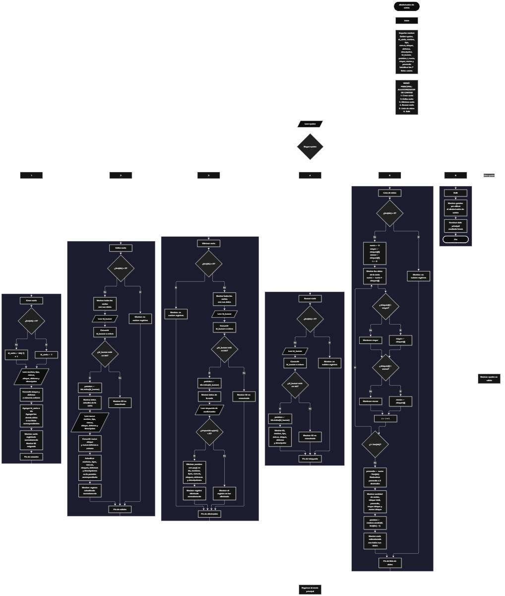

 

Este proyecto, llamado <b>aleatorizador de cartas</b>, fue desarrollado en <b>python</b> como un ejercicio práctico para fortalecer la lógica de programación mediante la creación de un sistema de gestión de cartas desde la consola. El programa cuenta con un menú principal de seis opciones que permite <b>crear, editar, eliminar, buscar, listar y seleccionar aleatoriamente</b> las cartas registradas. Cada carta almacena datos como el nombre, el tipo, la rareza, el ataque, la defensa y la descripción, utilizando siete listas paralelas que mantienen la información organizada durante la ejecución. Además, el sistema calcula estadísticas relacionadas con el ataque de las cartas, incluyendo el total, el promedio, el valor más alto y el valor más bajo. Para seleccionar una carta aleatoria, utiliza el módulo <b>random</b> y la función <b>randint()</b>, que permite elegir una posición válida entre los registros existentes. Durante su desarrollo se aplicaron conceptos fundamentales de programación, como variables, listas, estructuras condicionales, ciclos repetitivos, operaciones con listas y generación de números aleatorios. Este proyecto permite poner en práctica los conocimientos adquiridos en Python y sirve como base para desarrollar sistemas de gestión y selección aleatoria más avanzados.

<h2 align="center">⚙️ Funcionamiento del menú principal</h2>

### ➕ Crear carta

La opción <b>1) crear carta</b> permite registrar una nueva carta en el sistema. Antes de solicitar los datos, el programa comprueba si la lista <b>ids</b> está vacía mediante la condición <b>len(ids) == 0</b>. Si no existen registros, asigna el identificador <b>1</b> a la primera carta. En caso contrario, genera el siguiente identificador utilizando la expresión <b>ids[-1] + 1</b>, que obtiene el último identificador almacenado y le suma uno. Después, solicita el <b>nombre, tipo, rareza, ataque, defensa y descripción</b> de la carta. Los valores de ataque y defensa se convierten a números enteros mediante la función <b>int()</b>. A continuación, utiliza el método <b>append()</b> para almacenar el identificador y cada uno de los datos en sus respectivas listas. Finalmente, muestra el mensaje <b>"carta registrada correctamente."</b> e informa el identificador asignado. Los datos se mantienen en memoria mientras el programa continúa ejecutándose.

### ✏️ Editar carta

La opción <b>2) editar carta</b> permite modificar los datos de una carta registrada. Primero, el programa comprueba si existen registros mediante la condición <b>len(ids) == 0</b>. Si no hay cartas almacenadas, muestra el mensaje <b>"no existen registros."</b>. En caso contrario, presenta la información de todas las cartas mediante un ciclo <b>for</b>, mostrando el identificador, nombre, tipo, rareza, ataque, defensa y descripción. Después, solicita el identificador del registro que se desea editar y comprueba si se encuentra dentro de la lista <b>ids</b>. Si existe, utiliza <b>ids.index(id_buscar)</b> para obtener la posición correspondiente y muestra los datos actuales de la carta. Posteriormente, solicita el nuevo nombre, tipo, rareza, ataque, defensa y descripción, actualizando directamente los valores de las listas correspondientes. Los nuevos valores de ataque y defensa se convierten mediante <b>int()</b>. Finalmente, presenta el mensaje <b>"registro actualizado correctamente."</b>. Si el identificador no se encuentra, muestra el mensaje <b>"id no encontrada."</b>. El identificador original permanece sin cambios durante la edición.

### 🗑️ Eliminar carta

La opción <b>3) eliminar carta</b> permite eliminar una carta registrada mediante su identificador. Antes de comenzar, el programa comprueba si existen registros almacenados. Si las listas están vacías, muestra el mensaje <b>"no existen registros."</b>. Si existen cartas, presenta una lista con todos sus datos y solicita el identificador del registro que se desea eliminar. Después, verifica si el identificador está presente en <b>ids</b>. Si existe, utiliza <b>ids.index(id_buscar)</b> para obtener la posición de la carta y muestra sus datos antes de solicitar la confirmación mediante la pregunta <b>"¿desea eliminar este registro? (s/n):"</b>. La respuesta se convierte a mayúsculas mediante <b>upper()</b> y se compara con el valor <b>"S"</b>. Si el usuario confirma la operación, el programa utiliza el método <b>pop(posicion)</b> para eliminar la misma posición en las siete listas: <b>ids, nombres, tipos, rarezas, ataques, defensas y descripciones</b>. Finalmente, muestra el mensaje <b>"registro eliminado correctamente."</b>. Si el usuario no confirma la eliminación, presenta el mensaje <b>"el registro no fue eliminado."</b>. Si el identificador no existe, informa que no se encontró.

### 🔎 Buscar carta

La opción <b>4) buscar carta</b> permite localizar una carta mediante su identificador. Primero, el programa comprueba si existen registros almacenados. Si no hay cartas, muestra el mensaje <b>"no existen registros."</b>. En caso contrario, solicita el identificador que se desea buscar y comprueba si se encuentra en la lista <b>ids</b>. Cuando existe una coincidencia, utiliza <b>ids.index(id_buscar)</b> para obtener la posición correspondiente y muestra todos los datos de la carta: identificador, nombre, tipo, rareza, ataque, defensa y descripción. Si el identificador no se encuentra en la lista, presenta el mensaje <b>"id no encontrada."</b>. Esta función facilita la consulta individual de una carta sin necesidad de mostrar todos los registros.

### 📋 Lista de datos, estadísticas y selección aleatoria

La opción <b>5) lista de datos</b> permite visualizar todas las cartas registradas, calcular estadísticas relacionadas con sus valores de ataque y seleccionar una carta aleatoriamente. Primero, el programa comprueba si existen registros. Si no hay cartas almacenadas, muestra el mensaje <b>"no existen registros."</b>. En caso contrario, inicializa la variable <b>suma</b> con el valor <b>0</b> y utiliza el primer elemento de la lista <b>ataques</b> para inicializar las variables <b>mayor</b> y <b>menor</b>. Después, recorre las cartas mediante un ciclo <b>for</b>, muestra sus datos y acumula los valores de ataque en la variable <b>suma</b>. Durante el recorrido, compara cada ataque con los valores de <b>mayor</b> y <b>menor</b> para actualizar el ataque más alto y el más bajo. Al finalizar, calcula el promedio mediante la expresión <b>suma / len(ids)</b> y utiliza <b>round(promedio, 2)</b> para redondear el resultado a dos decimales. El programa muestra la cantidad de cartas, el ataque total, el ataque promedio, el mayor ataque y el menor ataque. Finalmente, utiliza <b>random.randint(0, len(ids) - 1)</b> para generar una posición aleatoria válida y mostrar los datos de la carta seleccionada. La selección se realiza entre las cartas registradas y cada posición tiene la misma probabilidad de ser elegida. Esta operación se ejecuta cada vez que se selecciona la opción 5 y existen registros.

### 🚪 Salir del menú principal

La opción <b>6) salir</b> permite finalizar la ejecución del programa. Cuando el usuario selecciona esta opción, el sistema muestra el mensaje <b>"gracias por utilizar el aleatorizador de cartas."</b> y ejecuta la instrucción <b>break</b>, que interrumpe el ciclo <b>while True</b> del menú principal. De esta manera, el programa deja de mostrar las opciones y termina su ejecución. Si el usuario introduce un valor que no corresponde a ninguna de las seis opciones disponibles, el bloque <b>else</b> muestra el mensaje <b>"opción no válida."</b> y el menú continúa activo.

<h2 align="center">🧠 Temas aplicados en el proyecto</h2>

### 📦 Variables

En este proyecto se utilizan variables para almacenar los datos de las cartas, controlar las opciones seleccionadas en el menú, identificar los registros que se desean editar, eliminar o buscar y calcular las estadísticas de ataque. También se utilizan variables para guardar la posición de una carta seleccionada aleatoriamente y controlar los recorridos de las listas. Cada variable cumple una función específica dentro de las operaciones del sistema.

🔢 **Opcion:** Almacena la opción seleccionada por el usuario en el menú principal.

🆔 **Id_carta:** Almacena el identificador asignado a la nueva carta durante su registro.

📝 **Nombre:** Almacena el nombre de la carta que se está registrando.

🏷️ **Tipo:** Almacena el tipo de carta.

💎 **Rareza:** Almacena la rareza de la carta.

⚔️ **Ataque:** Almacena el valor de ataque de la carta.

🛡️ **Defensa:** Almacena el valor de defensa de la carta.

📄 **Descripcion:** Almacena la descripción de la carta.

🔎 **Id_buscar:** Almacena el identificador introducido por el usuario para localizar un registro.

📍 **Posicion:** Almacena la posición de una carta dentro de las listas, tanto durante las operaciones de edición y eliminación como durante la selección aleatoria.

🔄 **I:** Funciona como contador en los ciclos `for` y permite recorrer las posiciones de las listas.

➕ **Suma:** Acumula los valores de ataque de todas las cartas registradas.

📈 **Mayor:** Almacena el mayor valor de ataque encontrado durante el recorrido.

📉 **Menor:** Almacena el menor valor de ataque encontrado durante el recorrido.

📊 **Promedio:** Almacena el resultado de dividir la suma de los ataques entre la cantidad de cartas registradas.

### 🗃️ Listas

En este proyecto se utilizan siete listas paralelas para almacenar la información de las cartas. Todas las listas se encuentran inicialmente vacías y se relacionan mediante sus posiciones. Esto significa que los datos ubicados en una misma posición corresponden a una misma carta. Por ejemplo, la información de la primera carta se encuentra distribuida entre <b>ids[0], nombres[0], tipos[0], rarezas[0], ataques[0], defensas[0] y descripciones[0]</b>. Esta organización permite registrar, consultar, modificar y eliminar cartas manteniendo la correspondencia entre sus datos. Las listas no tienen una capacidad máxima definida explícitamente en el código.

🆔 **Ids:** Almacena los identificadores de las cartas registradas.

📝 **Nombres:** Almacena los nombres de las cartas.

🏷️ **Tipos:** Almacena los tipos de las cartas.

💎 **Rarezas:** Almacena las rarezas de las cartas.

⚔️ **Ataques:** Almacena los valores de ataque de las cartas y se utiliza para calcular las estadísticas.

🛡️ **Defensas:** Almacena los valores de defensa de las cartas.

📄 **Descripciones:** Almacena las descripciones de las cartas.

### 🔀 Estructuras condicionales

En este proyecto se utilizan las estructuras <b>if, elif y else</b> para controlar el funcionamiento del menú principal y las operaciones de gestión. Estas condiciones permiten determinar qué opción seleccionó el usuario, comprobar si existen cartas registradas, verificar si un identificador se encuentra en la lista <b>ids</b>, confirmar la eliminación de un registro y comparar los valores de ataque para calcular los máximos y mínimos. También se utilizan para distinguir entre una operación válida, un registro encontrado y un identificador inexistente. De esta manera, el programa ejecuta diferentes instrucciones según las condiciones que se cumplen durante su funcionamiento.

### 🔄 Estructuras repetitivas

En este proyecto se utilizan los ciclos <b>while</b> y <b>for</b>. El ciclo <b>while True</b> mantiene activo el menú principal para que el usuario pueda realizar diferentes operaciones hasta seleccionar la opción de salida, que utiliza <b>break</b> para finalizar el ciclo. Por otro lado, los ciclos <b>for</b> permiten recorrer las listas para mostrar todas las cartas durante las operaciones de edición y eliminación, así como durante el listado y el cálculo de estadísticas. Estos recorridos utilizan <b>range(len(ids))</b> para obtener las posiciones correspondientes a los registros existentes.

### 🎯 Selección mediante condiciones

El programa utiliza una estructura condicional formada por <b>if, elif y else</b> para evaluar la variable <b>opcion</b> y ejecutar la operación correspondiente. Las seis opciones permiten crear, editar, eliminar, buscar, listar cartas o salir del sistema. El bloque <b>else</b> gestiona las entradas que no coinciden con ninguna de las opciones disponibles, mostrando el mensaje <b>"opción no válida."</b>. Esta estructura organiza las funciones del programa y facilita el acceso a cada operación desde un único menú principal.

### 🔢 Operaciones con listas

Las listas permiten almacenar y administrar los datos de las cartas durante la ejecución del programa. Para añadir nuevos registros se utiliza <b>append()</b>, que agrega cada dato al final de su lista correspondiente. Para localizar la posición de una carta a partir de su identificador se utiliza <b>index()</b>, mientras que el operador <b>in</b> permite comprobar si el identificador existe. Durante la eliminación se utiliza <b>pop(posicion)</b> en todas las listas para retirar los datos de la carta seleccionada. También se utiliza <b>len()</b> para conocer la cantidad de cartas registradas y determinar las posiciones que deben recorrerse. Estas operaciones permiten mantener las listas paralelas coordinadas.

### 🎲 Generación de números aleatorios

El proyecto incorpora el módulo <b>random</b> mediante la instrucción <b>import random</b>. En la opción de lista de datos, utiliza la función <b>random.randint(0, len(ids) - 1)</b> para generar un número entero aleatorio entre cero y el índice de la última carta registrada. El resultado se almacena en la variable <b>posicion</b>, que posteriormente se utiliza para mostrar los datos de la carta seleccionada. Como el programa verifica previamente que existan registros, el intervalo utilizado contiene posiciones válidas. La selección se basa en el índice de las listas y no considera diferencias entre la rareza, el ataque o la defensa de las cartas.

### 📊 Cálculo de estadísticas

El programa realiza operaciones matemáticas para analizar los valores de ataque de las cartas registradas. La variable <b>suma</b> acumula todos los ataques, mientras que las variables <b>mayor</b> y <b>menor</b> permiten identificar los valores máximo y mínimo durante el recorrido. El promedio se obtiene dividiendo la suma entre la cantidad de cartas registradas, utilizando <b>len(ids)</b> como divisor. Finalmente, la función <b>round()</b> redondea el promedio a dos decimales para presentar el resultado. Estas estadísticas permiten consultar de manera resumida los valores de ataque almacenados.

### 🔄 Organización de registros

Las cartas se organizan mediante siete listas paralelas que mantienen sus datos en posiciones equivalentes. Durante el registro, los nuevos valores se agregan al final de cada lista. Durante la edición, se actualiza la posición correspondiente sin modificar el identificador. Durante la eliminación, se utiliza <b>pop(posicion)</b> para retirar el elemento de todas las listas relacionadas. Python desplaza automáticamente los elementos posteriores de cada lista una posición hacia atrás, por lo que no es necesario implementar manualmente un ciclo de reorganización. Esta organización permite conservar la correspondencia entre los datos de las cartas que permanecen registradas.

<h2 align="center">¿Cómo se implementaron las operaciones crud en el proyecto?</h2>

Las operaciones <b>crud</b> se implementaron mediante las opciones del menú principal para administrar las cartas registradas. La operación <b>crear</b> corresponde a <b>crear carta</b>, donde se solicitan los datos y se almacenan mediante el método <b>append()</b>. La operación <b>leer</b> se realiza mediante las opciones <b>buscar carta</b> y <b>lista de datos</b>, que permiten consultar registros individuales o visualizar todas las cartas junto con sus estadísticas. La operación <b>actualizar</b> corresponde a <b>editar carta</b>, donde se modifican los datos de una carta existente sin cambiar su identificador. Por último, la operación <b>eliminar</b> corresponde a <b>eliminar carta</b>, donde se solicita una confirmación y se retira el registro de todas las listas mediante <b>pop()</b>. Estas operaciones permiten gestionar la información de las cartas durante la ejecución del programa, aunque los registros no se conservan automáticamente después de cerrar la aplicación.

<h2 align="center">Diagrama de flujo del proyecto</h2>

<h2 align="center">🛡️ Validaciones del programa</h2>

### 📭 No existen registros

Esta validación se utiliza en las opciones de <b>editar, eliminar, buscar y lista de datos</b>. El programa comprueba si la lista <b>ids</b> está vacía mediante la condición <b>len(ids) == 0</b>. Si no existen cartas registradas, muestra el mensaje <b>"no existen registros."</b> e impide continuar con las operaciones que necesitan datos almacenados. En las operaciones de edición, eliminación y búsqueda, esta comprobación evita intentar localizar una carta cuando no hay registros. En la opción de listado, evita realizar los cálculos estadísticos y la selección aleatoria sin cartas disponibles.

### ❌ Identificador no encontrado

Esta validación se utiliza en las opciones de <b>editar, eliminar y buscar carta</b>. Después de solicitar el identificador, el programa comprueba si el valor introducido se encuentra en la lista <b>ids</b> mediante la condición <b>id_buscar in ids</b>. Si existe, obtiene la posición correspondiente y continúa con la operación seleccionada. Si no existe, muestra el mensaje <b>"id no encontrada."</b>. Esta comprobación permite evitar que el programa intente modificar, eliminar o consultar una carta que no se encuentra registrada.

### ⚠️ Confirmación de eliminación

Esta validación se utiliza durante la eliminación de una carta. Después de localizar el registro y mostrar sus datos, el programa solicita una respuesta al usuario. La condición <b>respuesta.upper() == "S"</b> permite aceptar tanto la letra mayúscula como la minúscula. Si la respuesta es afirmativa, el programa elimina la carta de las siete listas. Si la respuesta es diferente de <b>"S"</b>, cancela la operación y muestra el mensaje <b>"el registro no fue eliminado."</b>. El código no exige que la respuesta sea exclusivamente <b>"S"</b> o <b>"N"</b>; cualquier otro valor también cancela la eliminación.

### 🔢 Conversión de valores numéricos

El programa utiliza la función <b>int()</b> para convertir los identificadores introducidos por el usuario y los valores de ataque y defensa a números enteros. Esta conversión permite trabajar con datos numéricos en las operaciones de búsqueda y en los cálculos estadísticos. Sin embargo, el código no incluye estructuras <b>try ... except</b> para controlar errores de conversión. Si el usuario introduce un valor no numérico donde se espera un entero, el programa puede finalizar con una excepción. Tampoco se comprueba que los valores de ataque y defensa sean positivos o estén dentro de un intervalo específico.

### 📈 Cálculo de estadísticas

La opción de lista de datos comprueba primero que existan cartas registradas antes de inicializar las variables de estadísticas y realizar los cálculos. La variable <b>suma</b> acumula los valores de ataque, mientras que <b>mayor</b> y <b>menor</b> se inicializan con el primer elemento de la lista <b>ataques</b>. De esta manera, el programa dispone de un valor inicial para realizar las comparaciones. El promedio se calcula dividiendo la suma entre <b>len(ids)</b>, por lo que el cálculo solo se ejecuta cuando existe al menos una carta registrada. Las estadísticas se calculan únicamente a partir del ataque, sin incluir los valores de defensa.

### 🎲 Selección aleatoria de cartas

La selección aleatoria se realiza después de mostrar las cartas y calcular sus estadísticas. Antes de ejecutarla, el programa comprueba que existan registros. Después, la función <b>random.randint(0, len(ids) - 1)</b> genera una posición entre cero y el último índice disponible. La variable <b>posicion</b> permite recuperar los datos correspondientes en todas las listas y mostrar la carta seleccionada. Como la selección se basa en una posición aleatoria, cada carta registrada tiene la misma probabilidad de ser elegida, independientemente de su rareza, ataque o defensa. El programa no guarda un historial de selecciones ni impide que una carta pueda aparecer nuevamente en una selección posterior.

### ⚠️ Opción no válida

La estructura condicional del menú principal incluye un bloque <b>else</b> que se ejecuta cuando el valor introducido no coincide con ninguna de las seis opciones disponibles. En ese caso, el programa muestra el mensaje <b>"opción no válida."</b> y vuelve a presentar el menú gracias al ciclo <b>while True</b>. Esta comprobación contempla las opciones no reconocidas, pero no valida que la entrada sea un número ni controla excepciones producidas por conversiones numéricas en las demás operaciones.

### 💾 Almacenamiento temporal

Los datos de las cartas se almacenan en listas que existen únicamente durante la ejecución del programa. El código no incorpora archivos, bases de datos ni otros mecanismos de persistencia. Por esta razón, las cartas registradas, sus modificaciones y los resultados de las estadísticas se conservan mientras la aplicación permanece activa, pero se pierden cuando finaliza la ejecución. Para mantener los registros entre diferentes ejecuciones sería necesario incorporar posteriormente un mecanismo de almacenamiento permanente.

<h2 align="center">🎯 Objetivo del proyecto</h2>

El objetivo principal de este proyecto es fortalecer la <b>lógica de programación</b> mediante el desarrollo de un sistema de gestión y selección aleatoria de cartas en <b>python</b>. A través de su construcción se busca aplicar los conocimientos adquiridos sobre variables, listas, estructuras condicionales, ciclos repetitivos, operaciones con colecciones y generación de números aleatorios. Además, el proyecto permite comprender cómo registrar, consultar, modificar y eliminar información, calcular estadísticas a partir de datos almacenados y seleccionar elementos de manera aleatoria. De esta forma, constituye una base práctica para desarrollar aplicaciones más completas que incorporen validaciones avanzadas, almacenamiento permanente y nuevas funcionalidades relacionadas con la administración de cartas.

